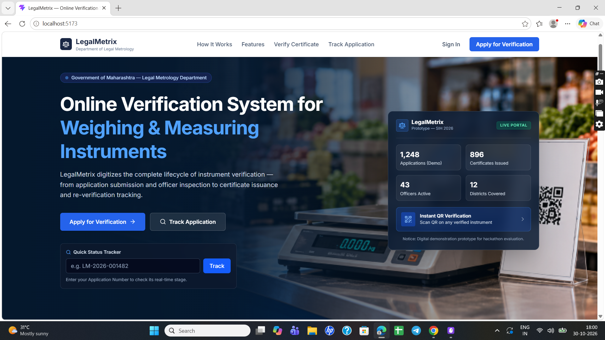
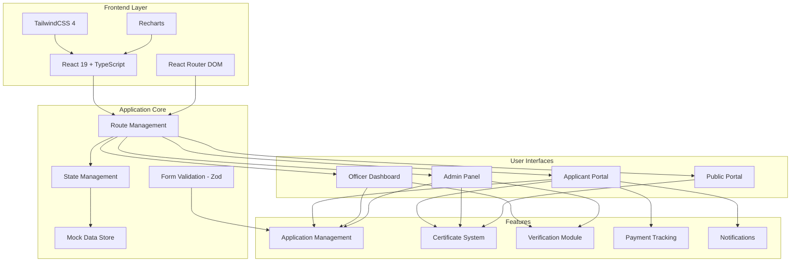
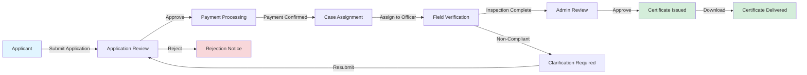
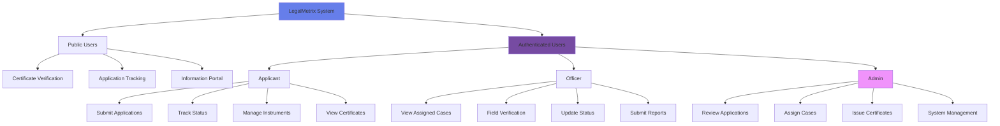
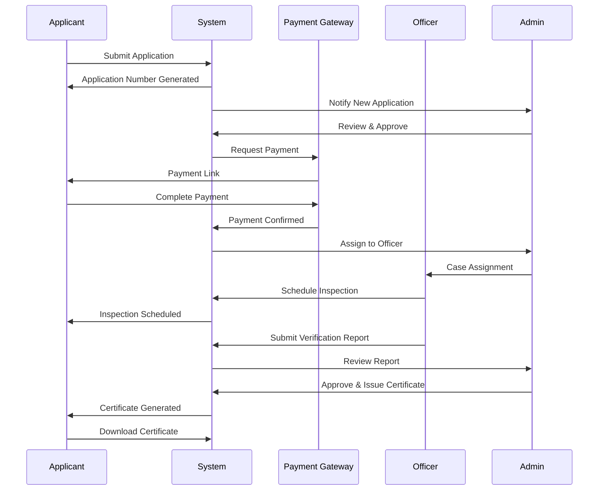
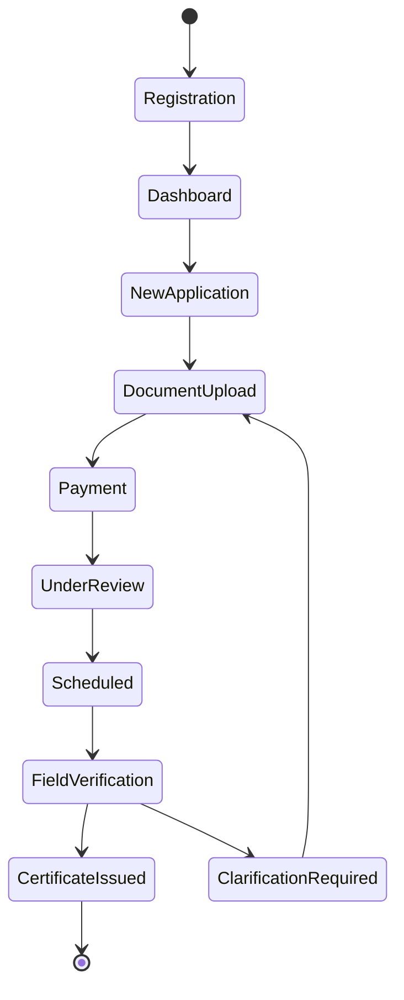
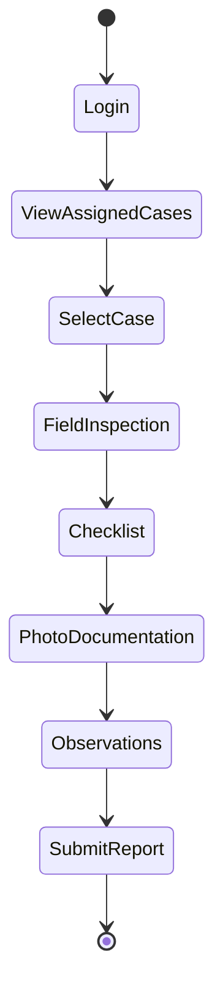
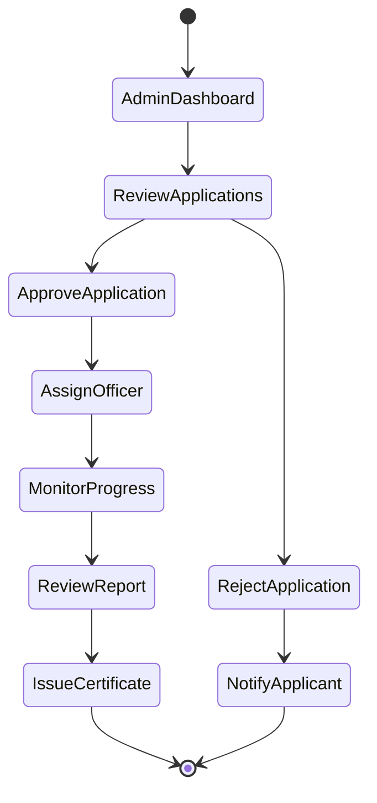

# 🏛️ LegalMetrix - Legal Metrology Certificate Management System

<div align="center">


**A Modern Digital Platform for Weights & Measures Certificate Management**

[](https://www.typescriptlang.org/)
[](https://reactjs.org/)
[](https://vitejs.dev/)
[](https://tailwindcss.com/)
[](LICENSE)

[Features](#-features) • [Demo](#-demo) • [Architecture](#-architecture) • [Installation](#-installation) • [Usage](#-usage) • [Tech Stack](#-tech-stack)

</div>

---

## 📋 Table of Contents

- [Overview](#-overview)
- [Features](#-features)
- [Demo Screenshots](#-demo)
- [System Architecture](#-architecture)
- [User Roles & Workflows](#-user-roles--workflows)
- [Installation](#-installation)
- [Usage](#-usage)
- [Tech Stack](#-tech-stack)
- [Project Structure](#-project-structure)
- [Data Models](#-data-models)
- [Contributing](#-contributing)
- [License](#-license)

---

## 🎯 Overview

**LegalMetrix** is a comprehensive digital platform designed to modernize and streamline the Legal Metrology Department's certification and verification processes. The system digitizes the entire workflow from application submission to certificate issuance, enabling efficient management of weights and measures instruments across multiple stakeholders.

### 🌟 Key Highlights

- **Multi-Role Dashboard System** - Tailored interfaces for Applicants, Officers, and Admins
- **Complete Application Lifecycle** - End-to-end digital workflow management
- **Real-time Tracking** - Live status updates and notifications
- **Digital Certificates** - QR-based verification and validation
- **Field Verification Module** - Mobile-ready inspection checklist system
- **Payment Integration Ready** - Built-in payment tracking framework
- **Re-verification Management** - Automated tracking of instrument renewal cycles

---

## ✨ Features

### 👥 For Applicants
- 📝 **Online Application Submission** - Digital forms for instrument verification/re-verification
- 📊 **Personal Dashboard** - Overview of all applications and instruments
- 📄 **Document Management** - Upload and track verification documents
- 💳 **Payment Tracking** - View payment status and history
- 🔔 **Smart Notifications** - Real-time updates on application status
- 📜 **My Certificates** - Access and download digital certificates
- ⏰ **Re-verification Reminders** - Automatic alerts for upcoming renewals
- 🔍 **Application Tracking** - Monitor progress at every stage

### 👮 For Verification Officers
- 📋 **Case Management Dashboard** - View assigned cases and workload
- 📍 **Field Verification Module** - Complete inspection checklist system
- ✅ **Compliance Checklist** - Standardized verification parameters
- 📸 **Photo Documentation** - Attach inspection images
- 📝 **Observation Notes** - Record detailed findings
- 📊 **Performance Metrics** - Track completed inspections
- 🗺️ **Zone-based Assignment** - Geographic case allocation

### 🛡️ For Admin
- 📈 **Analytics Dashboard** - System-wide metrics and insights
- 👥 **Application Review** - Review and approve submissions
- 👨‍💼 **Officer Management** - Assign cases to field officers
- 📜 **Certificate Issuance** - Generate and issue certificates
- 🔧 **System Configuration** - Manage application parameters
- 📊 **Reports & Analytics** - Generate comprehensive reports
- 🔍 **Audit Trail** - Complete activity logging

### 🌐 Public Features
- 🔎 **Certificate Verification** - QR code and certificate number validation
- 📱 **Application Tracking** - Public tracking with application ID
- 📚 **Information Portal** - Guidelines and resources

---

## 🎨 Demo

### Landing Page

*Modern, intuitive landing page with quick access to all features*

### Applicant Dashboard

*Comprehensive dashboard showing applications, instruments, and notifications*

### New Application

*User-friendly multi-step application form with document upload*

### My Certificates

*Digital certificate management with QR codes and download options*

### Officer Dashboard

*Field officer interface with assigned cases and inspection tools*

### Admin Dashboard

*Administrative control panel with analytics and management tools*

### Payment Tracking

*Integrated payment tracking and transaction history*

---

## 🏗️ Architecture

### System Architecture



### Application Flow



### User Role Hierarchy



### Data Flow Diagram



---

## 👥 User Roles & Workflows

### 1️⃣ Applicant Workflow



### 2️⃣ Officer Workflow



### 3️⃣ Admin Workflow



---

## 🚀 Installation

### Prerequisites

- **Node.js** >= 18.0.0
- **npm** >= 9.0.0 or **yarn** >= 1.22.0
- Modern web browser (Chrome, Firefox, Safari, Edge)

### Step 1: Clone the Repository

```bash
git clone https://github.com/Ajinkya-Ghuge/Mitramet.git
cd Mitramet
```

### Step 2: Install Dependencies

```bash
npm install
```

or with yarn:

```bash
yarn install
```

### Step 3: Start Development Server

```bash
npm run dev
```

or with yarn:

```bash
yarn dev
```

The application will be available at `http://localhost:5173`

### Step 4: Build for Production

```bash
npm run build
```

or with yarn:

```bash
yarn build
```

### Step 5: Preview Production Build

```bash
npm run preview
```

---

## 💻 Usage

### Development Mode

```bash
# Start development server with hot reload
npm run dev
```

Visit `http://localhost:5173` to see the application.

### Building for Production

```bash
# Compile TypeScript and build optimized bundle
npm run build

# Preview the production build locally
npm run preview
```

### Linting

```bash
# Run oxlint for code quality checks
npm run lint
```

### Testing Different User Roles

The application includes mock data for testing different user roles:

1. **Applicant View**: Navigate to `/dashboard`
2. **Officer View**: Navigate to `/officer/dashboard`
3. **Admin View**: Navigate to `/admin/dashboard`
4. **Public Verification**: Navigate to `/certificates/verify`

---

## 🛠️ Tech Stack

### Frontend Framework
- **React 19.3.1** - Latest React with improved performance and features
- **TypeScript 7.0.2** - Type-safe development
- **Vite 8.3.5** - Lightning-fast build tool and dev server

### Styling & UI
- **TailwindCSS 4.3.3** - Utility-first CSS framework
- **Lucide React 1.64.0** - Beautiful, consistent icons
- **Custom Components** - Reusable UI component library

### Routing & Navigation
- **React Router DOM 7.18.5** - Declarative routing for React

### Forms & Validation
- **React Hook Form 7.91.0** - Performant form management
- **Zod 4.6.7** - TypeScript-first schema validation
- **@hookform/resolvers 6.0.2** - Form validation integration

### Data Visualization
- **Recharts 3.10.1** - Composable charting library for React

### Code Quality
- **Oxlint 1.89.0** - Fast JavaScript/TypeScript linter
- **TypeScript ESLint** - TypeScript linting rules

### Build Tools
- **@vitejs/plugin-react 6.1.2** - Official Vite plugin for React
- **@tailwindcss/vite 4.3.3** - TailwindCSS integration for Vite

---

## 📁 Project Structure

```
legalmetrix/
├── 📂 public/
│   ├── favicon.svg
│   └── icons.svg
├── 📂 src/
│   ├── 📂 assets/
│   │   ├── hero-banner.png
│   │   ├── hero.png
│   │   └── *.svg
│   ├── 📂 components/
│   │   ├── 📂 layout/
│   │   │   ├── AppHeader.tsx          # Main application header
│   │   │   ├── AppShell.tsx           # Layout wrapper component
│   │   │   ├── PublicNavbar.tsx       # Public-facing navigation
│   │   │   └── Sidebar.tsx            # Side navigation menu
│   │   └── 📂 ui/
│   │       ├── EmptyState.tsx         # Empty state placeholder
│   │       ├── StatCard.tsx           # Dashboard statistic card
│   │       └── StatusBadge.tsx        # Status indicator badge
│   ├── 📂 data/
│   │   └── 📂 mock/
│   │       ├── index.ts               # Mock data definitions
│   │       └── store.ts               # LocalStorage data store
│   ├── 📂 pages/
│   │   ├── 📂 admin/
│   │   │   ├── AdminDashboard.tsx     # Admin control panel
│   │   │   └── ApplicationReview.tsx  # Application review interface
│   │   ├── 📂 applicant/
│   │   │   ├── ApplicantDashboard.tsx      # Applicant home
│   │   │   ├── MyApplications.tsx          # Applications list
│   │   │   ├── MyInstruments.tsx           # Instruments management
│   │   │   ├── NotificationsList.tsx       # Notifications center
│   │   │   ├── PaymentsList.tsx            # Payment history
│   │   │   ├── ProfileSettings.tsx         # User profile
│   │   │   └── ReverificationTracker.tsx   # Renewal tracking
│   │   ├── 📂 applications/
│   │   │   ├── ApplicationDetail.tsx  # Detailed view
│   │   │   └── NewApplication.tsx     # Application form
│   │   ├── 📂 certificates/
│   │   │   ├── CertificatesList.tsx   # Certificate management
│   │   │   └── PublicVerify.tsx       # Public verification
│   │   ├── 📂 landing/
│   │   │   └── LandingPage.tsx        # Public homepage
│   │   └── 📂 officer/
│   │       ├── FieldVerification.tsx  # Inspection interface
│   │       └── OfficerDashboard.tsx   # Officer home
│   ├── 📂 routes/
│   │   └── index.tsx                  # Route definitions
│   ├── 📂 types/
│   │   └── index.ts                   # TypeScript type definitions
│   ├── 📂 utils/
│   │   └── helpers.ts                 # Utility functions
│   ├── App.tsx                        # Root component
│   ├── App.css                        # Application styles
│   ├── main.tsx                       # Entry point
│   └── index.css                      # Global styles
├── .gitignore
├── .oxlintrc.json                     # Oxlint configuration
├── index.html                         # HTML entry point
├── package.json                       # Dependencies
├── tsconfig.json                      # TypeScript config
├── tsconfig.app.json                  # App-specific TS config
├── tsconfig.node.json                 # Node-specific TS config
├── vite.config.ts                     # Vite configuration
└── README.md                          # This file
```

---

## 🗄️ Data Models

### Core Entities

#### User
```typescript
interface User {
  id: string;
  name: string;
  email: string;
  phone: string;
  role: 'applicant' | 'officer' | 'admin' | 'public';
  avatarInitials: string;
}
```

#### Application
```typescript
interface Application {
  id: string;
  applicationNo: string;
  applicantId: string;
  instrumentId: string;
  type: 'Verification' | 'Re-verification';
  status: ApplicationStatus;
  submittedDate: string;
  totalInstruments: number;
  documents: Document[];
  payment: PaymentInfo;
}
```

#### Instrument
```typescript
interface Instrument {
  id: string;
  type: InstrumentType;
  make: string;
  model: string;
  serialNumber: string;
  capacity: string;
  status: 'Active' | 'Expired' | 'Pending' | 'Suspended';
  lastVerifiedDate?: string;
  nextVerificationDue?: string;
}
```

#### Certificate
```typescript
interface Certificate {
  id: string;
  certificateNo: string;
  applicationId: string;
  issueDate: string;
  validUpto: string;
  status: 'Valid' | 'Expired' | 'Revoked';
  qrCode: string;
}
```

### Supported Instrument Types

- Electronic Weighing Scale
- Petrol Dispenser
- Measuring Tape
- Measuring Tank
- LPG Dispenser
- Water Meter
- Milk Meter
- Platform Scale

### Application Status Flow

```
Submitted → Under Review → Approved → Scheduled → 
Field Verification → Certificate Issued
                   ↓
            Clarification Required → (back to Submitted)
                   ↓
                Rejected
```

---

## 🔧 Configuration

### Vite Configuration

The project uses Vite with React plugin and TailwindCSS integration:

```typescript
import { defineConfig } from 'vite';
import react from '@vitejs/plugin-react';
import tailwindcss from '@tailwindcss/vite';

export default defineConfig({
  plugins: [react(), tailwindcss()],
});
```

### TypeScript Configuration

Strict type checking enabled with React 19 support:
- `strict: true`
- `skipLibCheck: true`
- `esModuleInterop: true`
- React JSX transform

---

## 🎯 Key Features Implementation

### 1. Multi-Step Application Form
- Dynamic form with validation
- File upload support
- Progress indicator
- Auto-save draft capability

### 2. Dashboard Analytics
- Real-time statistics
- Interactive charts (Recharts)
- Responsive grid layout
- Quick action buttons

### 3. Certificate QR System
- QR code generation
- Public verification portal
- Certificate download (PDF ready)
- Expiry tracking

### 4. Field Verification Module
- Comprehensive checklist
- Photo upload capability
- GPS location tracking (ready)
- Digital signature support (ready)

### 5. Notification System
- Real-time alerts
- Categorized notifications
- Mark as read/unread
- Email integration (ready)

---

## 🔐 Security Considerations

- **Client-Side Validation**: Zod schema validation on all forms
- **Type Safety**: Full TypeScript coverage
- **XSS Protection**: React's built-in sanitization
- **Route Protection**: Role-based access control (ready)
- **Data Encryption**: HTTPS enforcement (production)
- **Secure Storage**: LocalStorage with encryption (ready)

---

## 🚧 Future Enhancements

### Phase 2 Planned Features
- [ ] Backend API integration (Node.js/Express or Spring Boot)
- [ ] PostgreSQL/MySQL database
- [ ] JWT authentication & authorization
- [ ] Real-time notifications (WebSocket)
- [ ] Email/SMS integration
- [ ] Payment gateway integration (Razorpay/Paytm)
- [ ] PDF certificate generation
- [ ] Advanced analytics dashboard
- [ ] Mobile app (React Native)
- [ ] Offline support (PWA)

### Phase 3 Planned Features
- [ ] AI-powered document verification
- [ ] Blockchain certificate validation
- [ ] Multi-language support
- [ ] Advanced reporting & analytics
- [ ] Integration with government databases
- [ ] Automated reminders & alerts
- [ ] Bulk application processing
- [ ] Advanced search & filters

---

## 🤝 Contributing

We welcome contributions! Please follow these steps:

1. **Fork the repository**
2. **Create a feature branch**
   ```bash
   git checkout -b feature/AmazingFeature
   ```
3. **Commit your changes**
   ```bash
   git commit -m 'Add some AmazingFeature'
   ```
4. **Push to the branch**
   ```bash
   git push origin feature/AmazingFeature
   ```
5. **Open a Pull Request**

### Development Guidelines

- Follow the existing code style
- Write meaningful commit messages
- Add comments for complex logic
- Update documentation as needed
- Test thoroughly before submitting PR

---

## 📝 License

This project is licensed under the **MIT License** - see the [LICENSE](LICENSE) file for details.

---

## 👨‍💻 Authors

**Ajinkya Ghuge**
- GitHub: [@Ajinkya-Ghuge](https://github.com/Ajinkya-Ghuge)

---

## 🙏 Acknowledgments

- **Legal Metrology Department** - For domain requirements and guidance
- **React Team** - For the amazing React 19 framework
- **Vite Team** - For the blazing-fast build tool
- **TailwindCSS** - For the utility-first CSS framework
- **Lucide** - For the beautiful icon set

---

## 📞 Support

For support, issues, or feature requests:
- 🐛 [Open an issue](https://github.com/Ajinkya-Ghuge/Mitramet/issues)
- 💬 [Start a discussion](https://github.com/Ajinkya-Ghuge/Mitramet/discussions)
- 📧 Email: [your-email@example.com]

---

## 📊 Project Status


**Current Phase**: MVP Development ✅  
**Next Milestone**: Backend Integration 🚧

---

<div align="center">

### ⭐ Star this repository if you find it helpful!

Made with ❤️ for the Legal Metrology Department

</div>
